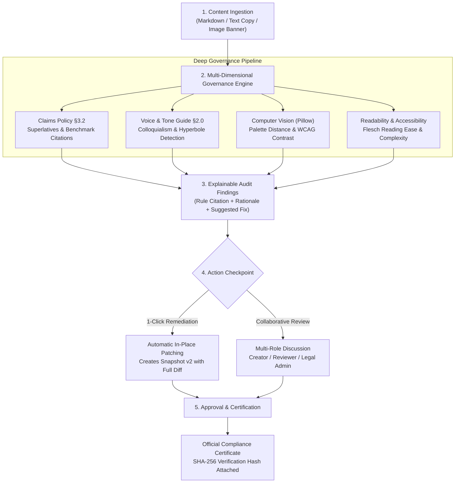

<p align="center">
  
</p>

<h2 align="center">🛡️ Intelligent Pre-Publication Brand Governance Platform</h2>
<p align="center">
  <strong>Round 2 Hackathon Project by Team CIPHER CODERS</strong><br />
  <em>Inkloom AI Hackathon • CODESTAR 30</em>
</p>

---

<p align="center">
  
  
  
  
  
  
</p>

---

# 🌌 BrandSphere AI: Pre-Publication Brand Governance

> *Safeguarding Enterprise Credibility in the Era of Autonomous Content Velocity.*
> **BrandSphere AI** is a multi-dimensional pre-publication brand governance platform that intercepts marketing collateral, press announcements, technical whitepapers, and visual banners **before** release.
> Rather than functioning as a blunt blocker, BrandSphere **educates rather than gates**: it detects ungrounded promotional superlatives, off-brand tone drift, and WCAG contrast failures, provides explainable policy citations, and offers **1-click context-preserving remediation** with cryptographic audit trails.

---

# ✨ Core Features & Capabilities

- ⚡ **Promotional Superlative & Claim Guard**: Scans assertion text against corporate policies (§3.2 Claim Grounding) to flag ungrounded superlatives (`fastest`, `#1`, `guaranteed 100%`) and cross-references assertions against the canonical truth library.
- 🎨 **Multi-Modal Visual Asset Auditor**: Built-in Computer Vision pipeline (Pillow + NumPy) analyzing creative banners, extracting dominant HEX color palettes, calculating Euclidean distance from brand tokens, and evaluating text-over-image WCAG 2.1 AA/AAA contrast ratios.
- 🔄 **1-Click Context Remediation & Version Snapshots**: Instant non-destructive text patching that preserves author voice while resolving violations; automatically increments document version snapshots (`v1` $\rightarrow$ `v2` $\rightarrow$ `v3`).
- 👥 **Multi-Tier Collaborative Review Studio**: Role-based workflow for **Creators**, **Reviewers**, and **Legal Admins** featuring threaded discussion comments, real-time status transitions, and audit logging.
- 🏆 **Cryptographic SHA-256 Publication Certification**: Approved documents receive an immutable digital certificate with reviewer signature, verification timestamp, and tamper-evident SHA-256 hash.
- 📚 **Dynamic Brand Knowledge Base (`/guidelines`)**: Manage enterprise policies, approved canonical fact sheets, and active vs. deprecated product terminology glossaries.
- 📊 **Guideline Clarity Index (GCI) & SLA Telemetry (`/analytics`)**: Real-time governance telemetry tracking resolution turnaround times, severity breakdown, and identifying ambiguous guidelines causing friction.
- 💎 **Bespoke Claymorphism Design System**: Tactile light-from-upper-left surfaces, Instrument Sans typography, high-contrast dark plum text (`#1f1823`, 11.2:1 to 14.1:1 AAA contrast), and a fully responsive layout with adaptive mobile hamburger drawer.

---

# 💡 Why This Project?

Modern enterprises generate unprecedented volumes of public-facing copy across decentralized global offices, agency partners, and AI writing assistants. This velocity triggers **Brand Entropy**:

- **What it solves**: Eliminates regulatory risk, false advertising liabilities, off-brand voice erosion, and visual accessibility violations prior to external release.
- **Why built**: Created for Round 2 of the **Inkloom AI Hackathon** to prove that brand governance can be proactive, explainable, and context-preserving rather than a frustrating bureaucratic bottleneck.
- **Why it matters**: A single unsupported superlative or inaccessible banner can trigger regulatory scrutiny or customer distrust; BrandSphere enforces compliance without slowing down publishing velocity.
- **Who it helps**:
  - **Content Creators & Marketing Teams**: Receive immediate pre-flight feedback and 1-click suggested fixes instead of cryptic rejections.
  - **Brand & Compliance Stewards**: Centrally manage single-source-of-truth guidelines, facts, and glossaries.
  - **Legal & Executive Leadership**: Gain cryptographic proof of verification and complete audit logs for every published piece.

---

# 🧩 Tech Stack


| Layer                  | Technology                  | Key Capabilities & Purpose                                                      |
| :----------------------- | :---------------------------- | :-------------------------------------------------------------------------------- |
| **Frontend Framework** | **Next.js 16 (App Router)** | Static site generation, server/client hybrid streaming, typed routes            |
| **UI Architecture**    | **React 19 + Tailwind CSS** | Bespoke Claymorphism tokens, fluid clamp typography, zero raw emojis            |
| **Iconography**        | **Lucide Icons**            | Accessible, responsive inline vector icons (`Shield`, `PenTool`, `Scale`, etc.) |
| **Backend API**        | **FastAPI + Uvicorn**       | High-throughput asynchronous REST endpoints with Pydantic v2 validation         |
| **Persistence Engine** | **SQLite + SQLAlchemy 2.0** | Relational document management, automated startup schema migrations             |
| **Computer Vision**    | **Pillow (PIL) + NumPy**    | Dominant color quantization, Euclidean distance, WCAG luminance ratios          |
| **Cognitive Metrics**  | **Flesch Reading Ease**     | Automated readability and syntactic complexity scoring                          |
| **Testing Suite**      | **Pytest + Pytest-Asyncio** | 20 unit, integration, and persistence tests (100% pass rate)                    |

---

# 📂 Project Structure

```plaintext
brandsphere-AI/
├── .env.example
├── .gitignore
├── .python-version
├── README.md
├── neon.ts
├── package-lock.json
├── package.json
├── pytest.ini
├── 📁 backend/
│   ├── .env.example
│   ├── .python-version
│   ├── requirements.txt
│   ├── 📁 app/
│   │   ├── __init__.py
│   │   ├── cache.py
│   │   ├── database.py
│   │   ├── governance_engine.py
│   │   ├── llm_engine.py
│   │   ├── main.py
│   │   ├── models.py
│   │   ├── rag_engine.py
│   │   └── schemas.py
│   └── 📁 tests/
│       ├── conftest.py
│       ├── test_api.py
│       ├── test_enterprise_architecture.py
│       ├── test_extended_features.py
│       └── test_persistence.py
└── 📁 frontend/
    ├── .gitignore
    ├── eslint.config.mjs
    ├── next.config.ts
    ├── package-lock.json
    ├── package.json
    ├── postcss.config.mjs
    ├── tsconfig.json
    ├── 📁 public/
    │   ├── file.svg
    │   ├── globe.svg
    │   ├── next.svg
    │   ├── vercel.svg
    │   └── window.svg
    └── 📁 src/
        ├── 📁 app/
        │   ├── favicon.ico
        │   ├── globals.css
        │   ├── layout.tsx
        │   ├── page.tsx
        │   ├── 📁 analytics/
        │   │   └── page.tsx
        │   ├── 📁 dashboard/
        │   │   └── page.tsx
        │   ├── 📁 guidelines/
        │   │   └── page.tsx
        │   ├── 📁 review/
        │   │   └── page.tsx
        │   └── 📁 upload/
        │       └── page.tsx
        ├── 📁 components/
        │   └── Navbar.tsx
        └── 📁 lib/
            └── api.ts
```

---

# ⚙️ Getting Started & Local Setup

### Prerequisites

- **Python**: `3.10+` (Tested on Python `3.13`)
- **Node.js**: `18+` (Tested on Node.js `22+`)
- **Git**

---

### 1. Start the Backend API (FastAPI)

```bash
# Clone the repository
git clone https://github.com/Cipher-Shadow-IR/brandsphere-AI.git
cd brandsphere-AI

# Install backend dependencies
pip install -r backend/requirements.txt

# Start the backend server on port 8001
python -m uvicorn backend.app.main:app --host 0.0.0.0 --port 8001 --reload
```

- **API Base URL**: `http://localhost:8001`
- **Interactive Swagger Docs**: `http://localhost:8001/docs`
- **ReDoc Reference**: `http://localhost:8001/redoc`

---

### 2. Start the Frontend UI (Next.js 16)

```bash
# Open a second terminal and navigate to frontend/
cd frontend

# Install frontend dependencies
npm install

# Run the development server
npm run dev

# Alternatively, run the production build
npm run build
npm run start
```

- **Web Application URL**: `http://localhost:3000`
- **Governance Operations Dashboard**: `http://localhost:3000/dashboard`
- **Pre-Publication Scanner**: `http://localhost:3000/upload`
- **Review & Remediation Studio**: `http://localhost:3000/review`
- **Knowledge Base & Rule Sets**: `http://localhost:3000/guidelines`
- **Analytics & SLA Dashboard**: `http://localhost:3000/analytics`

---

# 🧪 Automated Testing & Verification

Run the full automated test suite verifying core APIs, computer vision checks, remediation, threaded collaboration, and persistence:

```bash
python -m pytest backend/tests/ -v
```

### ✅ Test Suite Results: 20 / 20 Tests Passed (100%)


| Test Case                                             | Module                      | Verification Target                                                                |
| :------------------------------------------------------ | :---------------------------- | :----------------------------------------------------------------------------------- |
| `test_root_endpoint`                                  | `test_api.py`               | API health status and persistent database operational check                        |
| `test_upload_document_success`                        | `test_api.py`               | Multi-issue document ingestion & rule violation extraction                         |
| `test_upload_document_validation_errors`              | `test_api.py`               | Pydantic schema validation for empty or malformed payloads                         |
| `test_get_documents_list`                             | `test_api.py`               | Document repository query and pagination verification                              |
| `test_get_document_by_id_success`                     | `test_api.py`               | Single document deep retrieval with attached issues                                |
| `test_get_document_nonexistent_returns_404`           | `test_api.py`               | 404 response handling for invalid document IDs                                     |
| `test_review_status_transitions`                      | `test_api.py`               | Lifecycle state transitions (`pending_review` $\rightarrow$ `approved`)            |
| `test_submit_review_nonexistent_document_returns_404` | `test_api.py`               | Validation boundary on review submission                                           |
| `test_submit_review_invalid_status_returns_422`       | `test_api.py`               | 422 Unprocessable Content validation on illegal states                             |
| `test_analytics_metrics`                              | `test_api.py`               | KPI aggregation, severity counts, and turnaround times                             |
| `test_guidelines_endpoint`                            | `test_api.py`               | Active policy retrieval across all governance categories                           |
| `test_guideline_crud_and_seeding`                     | `test_extended_features.py` | Guideline creation, retrieval, and startup seeding                                 |
| `test_approved_facts_library`                         | `test_extended_features.py` | Canonical fact assertion lookups and citation validation                           |
| `test_glossary_terms_and_enforcement`                 | `test_extended_features.py` | Active vs. deprecated terminology detection                                        |
| `test_remediation_and_revision_flow`                  | `test_extended_features.py` | 1-click remediation, version increment (`v1` $\rightarrow$ `v2`), issue resolution |
| `test_collaborative_threaded_comments`                | `test_extended_features.py` | Multi-role threaded feedback across Creators and Legal                             |
| `test_certified_publication_export`                   | `test_extended_features.py` | SHA-256 digital certificate generation and tamper check                            |
| `test_delete_document_and_cascading_cleanup`          | `test_extended_features.py` | Document deletion with cascading cleanup of issues and reviews                     |
| `test_seed_demo_documents_endpoint`                   | `test_extended_features.py` | Realistic demo scenario loading (Tech launch, non-compliant, visual ad)            |
| `test_persistence_across_restarts`                    | `test_persistence.py`       | SQLite disk persistence validation across server process restarts                  |

---

# 🧠 How It Works (End-to-End Workflow)



1. **Ingest**: The creator uploads copy drafts, social blurbs, or marketing creative images via `/upload` (or uses pre-loaded demo scenarios).
2. **Scan**: The engine scans assertions, evaluates readability, extracts dominant visual color palettes, and calculates WCAG contrast ratios.
3. **Audit & Explain**: Rather than returning a generic pass/fail, issues highlight exact snippets with citations to the corporate rulebook.
4. **Remediate**: The user triggers **1-Click Context Remediation** to patch ungrounded claims with approved factual benchmarks, generating a `v2` revision snapshot.
5. **Certify**: Legal and Compliance admins sign off on the release, generating an official **Cryptographic Brand Compliance Certificate** with an immutable SHA-256 hash.

---

# 🚀 Roadmap & Milestone Progress

- [X]  **Milestone 1**: Core rule engine for claim verification, voice tone, and Flesch readability.
- [X]  **Milestone 2**: Multi-modal creative asset auditor with Pillow computer vision and WCAG 2.1 AA/AAA evaluation.
- [X]  **Milestone 3**: 1-click context-preserving auto-remediation with revision snapshots (`v1`, `v2`, `v3`).
- [X]  **Milestone 4**: Multi-role review studio with persona switcher, threaded audit comments, and certificate modal.
- [X]  **Milestone 5**: Bespoke Claymorphism UI transformation with WCAG AAA contrast and adaptive mobile hamburger navigation.
- [X]  **Milestone 6**: Automated database schema migrations and resilient CORS regex.
- [ ]  **Milestone 7 (Next)**: Native PDF / DOCX binary document parsing pipeline (`pypdf` and `python-docx`).
- [ ]  **Milestone 8 (Next)**: Vector semantic search via FAISS / pgvector for fuzzy claim similarity matching.
- [ ]  **Milestone 9 (Next)**: Side-by-side visual image diff overlay for modified creative assets.

---

# 🛡️ Responsible AI, Security & Privacy

- **Zero-Retention Architecture**: Customer drafts, corporate collateral, and confidential press materials are never used to train public machine learning models.
- **Human Sovereignty**: Machine recommendations serve as explainable suggestions; final release approval remains strictly in the hands of authorized human stakeholders.
- **Auditable Paper Trail**: Every document creation, automated remediation, review comment, and status transition is recorded in the immutable database audit log.

---

# 🤝 Contributing

Contributions and ideas are welcome! To contribute:

1. Fork the Project: `git checkout -b feature/NewGovernanceRule`
2. Create your Feature Branch: `git commit -m 'feat: Add multilingual tone scanner'`
3. Verify Test Suite: `python -m pytest backend/tests/ -v`
4. Verify Frontend: `cd frontend && npm run typecheck && npm run build`
5. Push to Branch and Open a Pull Request

---

# 📜 License

Distributed under the **MIT License**. See `LICENSE` for more information.

---

# 👨‍💻 Authors & Team CIPHER CODERS

<p align="center">
  <strong>Team CIPHER CODERS — Inkloom AI Hackathon (Round 2)</strong><br />
  <em>Building the Future of Enterprise Pre-Publication Governance</em>
</p>

<p align="center">
  <a href="https://github.com/Cipher-Shadow-IR">
    
  </a>
  <a href="https://github.com/Cipher-Shadow-IR">
    
  </a>
</p>

### 👥 Team Roles & Ownership Matrix

| Member | Designated Role | Core Domain Responsibilities (per Submission Blueprint) |
| :--- | :--- | :--- |
| **Ishaan Ray** | **Team Leader** | • Problem Analysis & Solution Design<br />• End-to-End Product Architecture<br />• RAG Pipeline & Grounded Fact Verification<br />• Prompt Engineering & Hallucination Mitigation<br />• Technical Stack Selection & Feasibility Planning<br />• Product Workflow, Feature Planning & Submission Documentation |
| **Rishi Prajapati** | **Research & Validation** | • Retrieval, Embedding & Knowledge-Base Integration<br />• Backend Feature Development & API Integration<br />• Debugging, Performance Improvements & MVP Development<br />• ML/RAG Pipeline Implementation Support |

---

# ⭐ Support

If BrandSphere AI helps your organization prevent brand entropy and accelerate governance velocity:

```md
Give this repository a star ⭐ on GitHub!
```

---

<p align="center">
  <sub>Engineered with precision by Team CIPHER CODERS for the Inkloom AI Hackathon / CODESTAR 30.</sub>
</p>
