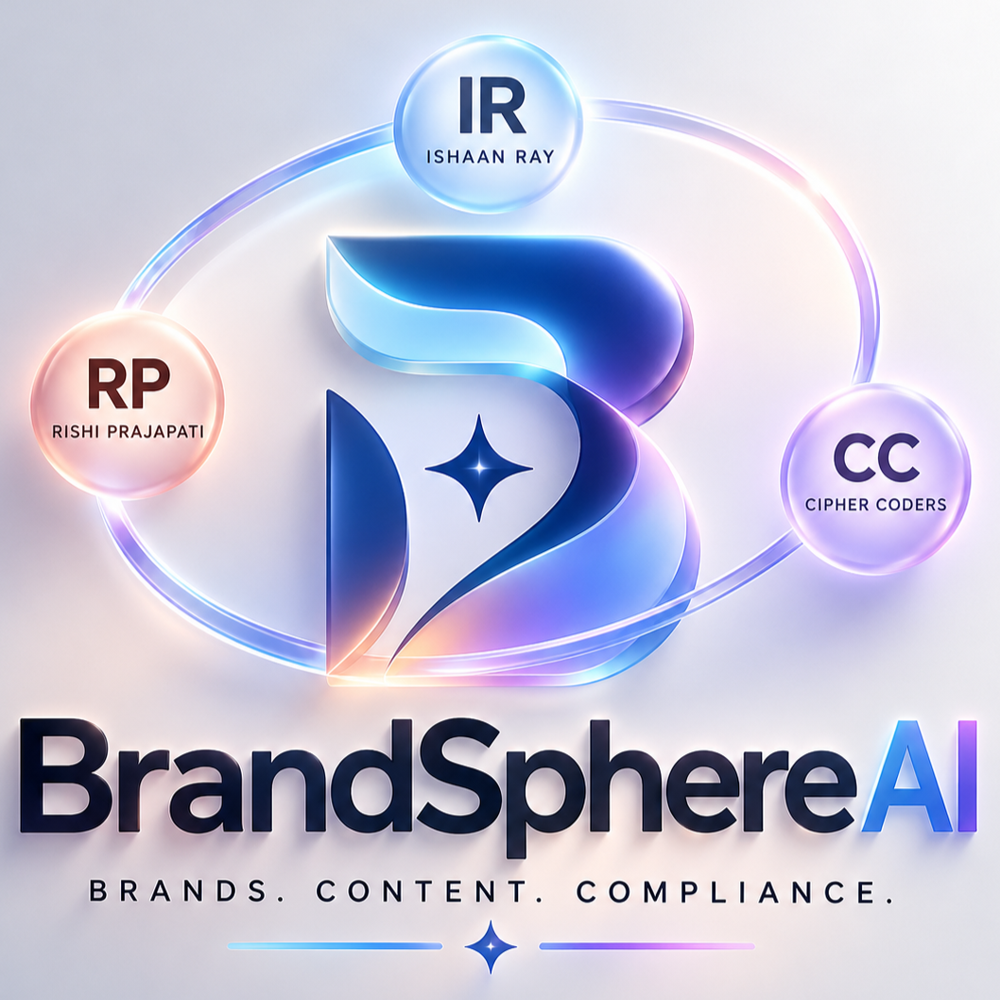
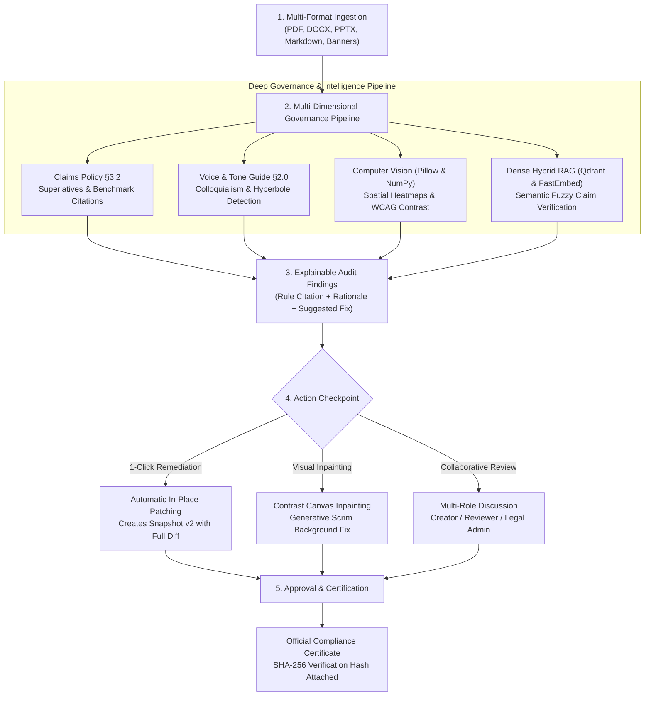

<p align="center">
  
</p>

<p align="center">
  
</p>

<h2 align="center">🛡️ Intelligent Pre-Publication Brand Governance Platform</h2>
<p align="center">
  <strong>Round 2 Hackathon Project by Team CIPHER CODERS</strong><br />
  <em>Inkloom AI Hackathon • CODESTAR 30</em>
</p>

<p align="center">
  <a href="https://brandsphere-ai-cs.vercel.app">
    
  </a>
  <a href="https://brandsphere-backend-fwdc.onrender.com/docs">
    
  </a>
  <a href="https://github.com/Cipher-Shadow-IR/brandsphere-AI/actions">
    
  </a>
</p>

<p align="center">
  
  
  
  
  
  
  
  
  
</p>

---

# 🌌 BrandSphere AI: Pre-Publication Brand Governance

> *Safeguarding Enterprise Credibility in the Era of Autonomous Content Velocity.*  
> **BrandSphere AI** is a multi-dimensional pre-publication brand governance platform that intercepts marketing collateral, press announcements, technical whitepapers, and visual banners **before** release.  
> Rather than functioning as a blunt blocker, BrandSphere **educates rather than gates**: it detects ungrounded promotional superlatives, off-brand tone drift, and WCAG contrast failures, provides explainable policy citations, offers **1-click context-preserving auto-remediation**, generates **tamper-evident SHA-256 digital certificates**, and integrates headless **CI/CD pre-commit hooks & CMS webhooks**.

---

# ✨ Core Features & Enterprise Capabilities

### 1. Ingestion & Multi-Format Parsing Engine
- ⚡ **Native Multi-Page Binary Document Parsing**: Ingests `.pdf`, `.docx`, `.pptx`, `.txt`, and `.md` files directly. Preserves multi-page structural context, table assertions, and embedded headers/footers using `pypdf`, `python-docx`, and `python-pptx`.
- ⚡ **Promotional Superlative & Claim Guard**: Scans assertion text against corporate policies (§3.2 Claim Grounding) to flag ungrounded superlatives (`fastest`, `#1`, `guaranteed 100%`) and cross-references assertions against the canonical truth library.

### 2. Multi-Modal Visual Asset & Contrast Studio
- 🎨 **Multi-Modal Visual Asset Auditor**: Built-in Computer Vision pipeline (Pillow + NumPy) analyzing creative banners, extracting dominant HEX color palettes, calculating Euclidean delta-E distance from brand tokens, and evaluating text-over-image WCAG 2.1 AA/AAA contrast ratios.
- 🖼️ **Visual Heatmap Diff Studio & Generative Contrast Inpainting**: Generates 9-region spatial pixel heatmaps identifying low-contrast zones and applies automated generative contrast-boosting adjustments and gradient scrims directly to banner graphics.

### 3. Review, Remediation & Governance Certification
- 🔄 **1-Click Context Remediation & Version Snapshots**: Instant non-destructive text patching that preserves author voice while resolving violations; automatically increments document version snapshots (`v1` $\rightarrow$ `v2` $\rightarrow$ `v3`).
- 👥 **Multi-Tier Collaborative Review Studio (`/review`)**: 3-Persona Role-Based Access Control (**Creator**, **Reviewer**, and **Legal Admin**) featuring threaded discussion comments, real-time status transitions, and audit logging.
- 🏆 **Cryptographic SHA-256 Publication Certification**: Approved documents receive an immutable digital certificate with reviewer signature, verification timestamp, and tamper-evident SHA-256 hash.

### 4. Dynamic Knowledge Base & SLA Telemetry
- 📚 **Dynamic Brand Knowledge Base (`/guidelines`)**: Manage enterprise policies, approved canonical fact sheets, and active vs. deprecated product terminology glossaries.
- 📊 **Guideline Clarity Index (GCI) & SLA Telemetry (`/analytics`)**: Real-time governance telemetry tracking resolution turnaround times, severity breakdown, and identifying ambiguous guidelines causing friction. Export audit reports instantly in PDF, Word, Markdown, CSV, and JSON.

### 5. Headless Automation & CI/CD Pipeline
- 🤖 **Headless CLI Scanner (`scripts/brandsphere-cli.py`)**: Run pre-publication governance scans in CI/CD build gates or standalone terminal workflows with `--strict` exit codes.
- 🪝 **Git Pre-Commit Hook (`scripts/pre-commit-hook.sh`)**: Automatically blocks commits containing ungrounded claims or deprecated brand terminology.
- 🌐 **CMS Webhook Receiver (`backend/app/webhooks.py`)**: Webhook endpoints for HubSpot, WordPress, and generic headless CMS integrations (`/api/webhooks/hubspot`, `/api/webhooks/wordpress`, `/api/webhooks/cms`).

---

# 💡 Why This Project?

Modern enterprises generate unprecedented volumes of public-facing copy across decentralized global offices, agency partners, and AI writing assistants. This velocity triggers **Brand Entropy**:

- **What it solves**: Eliminates regulatory risk, false advertising liabilities, off-brand voice erosion, and visual accessibility violations prior to external release.
- **Why built**: Created for the **Inkloom AI Hackathon (CODESTAR 30)** by Team **CIPHER CODERS** to prove that brand governance can be proactive, explainable, and context-preserving rather than a frustrating bureaucratic bottleneck.
- **Why it matters**: A single unsupported superlative or inaccessible banner can trigger regulatory scrutiny or customer distrust; BrandSphere enforces compliance without slowing down publishing velocity.
- **Who it helps**:
  - **Content Creators & Marketing Teams**: Receive immediate pre-flight feedback and 1-click suggested fixes instead of cryptic rejections.
  - **Brand & Compliance Stewards**: Centrally manage single-source-of-truth guidelines, facts, and glossaries.
  - **Legal & Executive Leadership**: Gain cryptographic proof of verification and complete audit logs for every published piece.

---

# 🧩 Enterprise Architecture & Tech Stack

```
┌─────────────────────────────────┐
│     Next.js 16 (App Router)     │ ──▶ Hosted on Vercel Edge CDN (Global Static Routing)
│       React 19 + Tailwind CSS   │     Bespoke Accessible Claymorphism UI
└─────────────────────────────────┘
                 │ (REST API & Webhooks)
                 ▼
┌─────────────────────────────────┐
│        FastAPI (Python 3.13)    │ ──▶ Hosted on Render Web Services (TLS 1.3 / ASGI)
│   Document Parser (PDF/DOC/PPT) │     Pydantic v2 Payload Validation & Structured Logs
└─────────────────────────────────┘
    │              │              │
    ▼              ▼              ▼
┌──────────────┐ ┌──────────────┐ ┌──────────────────────────────────────┐
│  Neon Cloud  │ │ Upstash Redis│ │ Embedded Qdrant & FastEmbed (CPU RAG)│
│  PostgreSQL  │ │   7 Caching  │ │   + Google Gemini 1.5 Flash (LLM)   │
└──────────────┘ └──────────────┘ └──────────────────────────────────────┘
```

| Layer | Technology | Key Capabilities & Purpose |
| :--- | :--- | :--- |
| **Frontend Framework** | **Next.js 16 (App Router)** | Static site generation, server/client hybrid streaming, typed routes |
| **UI Architecture** | **React 19 + Tailwind CSS** | Bespoke Claymorphism tokens, fluid clamp typography, zero raw emojis |
| **Iconography & Assets** | **Lucide Icons** | Accessible vector icons (`Shield`, `PenTool`, `Scale`, `Terminal`) |
| **Backend REST API** | **FastAPI + Uvicorn (ASGI)** | High-throughput asynchronous REST endpoints with Pydantic v2 validation |
| **Cloud Persistence** | **Neon Serverless PostgreSQL** | Relational document management, automated schema migrations, connection pooling |
| **Vector Search & RAG** | **Embedded Qdrant + FastEmbed** | Semantic similarity search across guidelines & canonical corporate facts |
| **High-Throughput Cache** | **Redis 7 (Upstash Serverless)** | Sub-45ms responses for cached document scans and compliance certificates |
| **Multimodal Intelligence** | **Google Gemini 1.5 Flash** | Contextual brand tone harmonization & multimodal visual asset evaluation |
| **Computer Vision Engine** | **Pillow (PIL) + NumPy** | Spatial pixel heatmaps, RGB quantization, WCAG luminance ratios, inpainting |
| **Document Parsing** | **pypdf + python-docx + python-pptx** | Binary parsing for multi-page PDF whitepapers, Word files, and PPTX decks |
| **Cognitive Metrics** | **Flesch Reading Ease** | Automated readability and syntactic complexity scoring |
| **Automation & CI/CD** | **GitHub Actions + CLI Hook** | Automated quality gates, pre-commit enforcement, and CMS webhooks |
| **Testing Suite** | **Pytest + Pytest-Asyncio** | 34 automated unit, integration, RAG, and persistence tests (**100% pass rate**) |

---

# 📂 Project Structure

```plaintext
brandsphere-AI/
├── .dockerignore
├── .env.example
├── .github/
│   └── workflows/
│       └── brand-governance.yml     # Enterprise CI/CD quality gate & CLI scanner
├── .gitignore
├── .python-version
├── LICENSE
├── README.md
├── docker-compose.yml
├── neon.ts
├── package-lock.json
├── package.json
├── pytest.ini
├── 📁 backend/
│   ├── .dockerignore
│   ├── .env.example
│   ├── .python-version
│   ├── Dockerfile
│   ├── requirements.txt
│   ├── 📁 app/
│   │   ├── __init__.py
│   │   ├── cache.py                 # Redis 7 caching service & in-memory TTL fallback
│   │   ├── database.py              # SQLAlchemy 2.0 ORM & Neon PostgreSQL connection pool
│   │   ├── document_parser.py       # Multi-page binary parser (PDF, DOCX, PPTX)
│   │   ├── governance_engine.py     # Rule engine, Pillow CV, WCAG contrast & inpainting
│   │   ├── llm_engine.py            # Gemini 1.5 Flash multimodal audit & remediation
│   │   ├── main.py                  # FastAPI server, REST routers, CORS & lifespan
│   │   ├── models.py                # Relational ORM models (Docs, Issues, Reviews, Facts)
│   │   ├── rag_engine.py            # Qdrant vector database & FastEmbed semantic search
│   │   ├── schemas.py               # Pydantic v2 request/response validation schemas
│   │   └── webhooks.py              # CMS webhook handlers (HubSpot, WordPress, generic)
│   └── 📁 tests/
│       ├── conftest.py
│       ├── test_api.py              # Root health, upload validation, review flows
│       ├── test_document_parser.py  # Binary PDF, DOCX, PPTX parsing & table tests
│       ├── test_enterprise_architecture.py # Neon DB, Qdrant RAG, and Redis cache tests
│       ├── test_extended_features.py# Knowledge base CRUD, remediation, certificates
│       ├── test_persistence.py      # Persistence validation across server restarts
│       ├── test_visual_contrast.py  # Spatial contrast heatmaps & inpainting tests
│       └── test_webhooks.py         # Headless CI/CD & CMS webhook verification
├── 📁 frontend/
│   ├── .dockerignore
│   ├── .gitignore
│   ├── Dockerfile
│   ├── eslint.config.mjs
│   ├── next.config.ts
│   ├── package-lock.json
│   ├── package.json
│   ├── postcss.config.mjs
│   ├── tsconfig.json
│   ├── 📁 public/
│   │   ├── BrandSphere-AI-Logo.png  # Official high-resolution brand asset
│   │   ├── favicon.ico
│   │   ├── icon.png
│   │   └── [svg icons]
│   └── 📁 src/
│       ├── 📁 app/
│       │   ├── favicon.ico
│       │   ├── globals.css          # Authoritative Claymorphism CSS tokens
│       │   ├── layout.tsx           # Global HTML layout with metadata & hydration guard
│       │   ├── page.tsx             # Interactive landing page with live simulator
│       │   ├── 📁 analytics/        # SLA metrics, Guideline Clarity Index, report export
│       │   ├── 📁 dashboard/        # Operations dashboard with KPI cushions & search
│       │   ├── 📁 guidelines/       # Dynamic Knowledge Base hub (Rules, Facts, Glossaries)
│       │   ├── 📁 review/           # Multi-persona review studio, visual diff & certs
│       │   └── 📁 upload/           # Pre-publication scanner with multi-file dropzone
│       ├── 📁 components/
│       │   ├── BrandLoader.tsx      # Tactile animated logo loading component
│       │   ├── Footer.tsx           # Enterprise footer with brand attribution & metadata
│       │   └── Navbar.tsx           # Responsive navigation bar with mobile drawer
│       └── 📁 lib/
│           └── api.ts               # Resilient API client with automatic production failover
└── 📁 scripts/
    ├── brandsphere-cli.py           # Headless pre-publication CLI governance scanner
    ├── pre-commit-hook.sh           # Git pre-commit hook preventing policy infractions
    └── sample-collateral.md         # Reference enterprise sample copy for testing
```

---

# 🐳 Instant Launch with Docker Compose (Recommended)

Run the entire enterprise ecosystem (Next.js 16 Frontend + FastAPI Backend + Redis 7 Cache + Qdrant Vector Engine) with a single command:

```bash
docker compose up --build
```

- **Frontend Application**: [`http://localhost:3000`](http://localhost:3000)
- **FastAPI Interactive Docs**: [`http://localhost:8000/docs`](http://localhost:8000/docs)
- **Qdrant Vector Engine**: [`http://localhost:6333/dashboard`](http://localhost:6333/dashboard)
- **Redis Cache Layer**: `localhost:6379`

To run in the background (detached mode):
```bash
docker compose up -d --build
```

To stop all services:
```bash
docker compose down
```

---

# ⚙️ Getting Started & Manual Local Setup

### Prerequisites

- **Python**: `3.10+` (Tested on Python `3.11` and `3.13`)
- **Node.js**: `18+` (Tested on Node.js `20+` and `22+`)
- **Git**

---

### 1. Start the Backend API (FastAPI)

```bash
# Clone the repository
git clone https://github.com/Cipher-Shadow-IR/brandsphere-AI.git
cd brandsphere-AI

# Install backend dependencies
pip install -r backend/requirements.txt

# Start the backend server on port 8001
python -m uvicorn backend.app.main:app --host 0.0.0.0 --port 8001 --reload
```

- **API Base URL**: `http://localhost:8001`
- **Interactive Swagger Docs**: `http://localhost:8001/docs`
- **ReDoc Reference**: `http://localhost:8001/redoc`

---

### 2. Start the Frontend UI (Next.js 16)

```bash
# Open a second terminal and navigate to frontend/
cd frontend

# Install frontend dependencies
npm install

# Run the development server
npm run dev

# Alternatively, run the production build
npm run build
npm run start
```

- **Web Application URL**: `http://localhost:3000`
- **Governance Operations Dashboard**: `http://localhost:3000/dashboard`
- **Pre-Publication Scanner**: `http://localhost:3000/upload`
- **Review & Remediation Studio**: `http://localhost:3000/review`
- **Knowledge Base & Rule Sets**: `http://localhost:3000/guidelines`
- **Analytics & SLA Dashboard**: `http://localhost:3000/analytics`

---

# 🧪 Automated Testing & Verification

Run the full automated test suite verifying core APIs, binary document parsing, computer vision contrast, inpainting, remediation, threaded collaboration, webhooks, and persistence:

```bash
python -m pytest backend/tests/ -v
```

### ✅ Test Suite Results: 34 / 34 Tests Passed (100%)

| Test Case | Module | Verification Target |
| :--- | :--- | :--- |
| `test_root_endpoint` | `test_api.py` | API health status and persistent database operational check |
| `test_upload_document_success` | `test_api.py` | Multi-issue document ingestion & rule violation extraction |
| `test_upload_document_validation_errors` | `test_api.py` | Pydantic schema validation for empty or malformed payloads |
| `test_get_documents_list` | `test_api.py` | Document repository query and pagination verification |
| `test_get_document_by_id_success` | `test_api.py` | Single document deep retrieval with attached issues |
| `test_get_document_nonexistent_returns_404` | `test_api.py` | 404 response handling for invalid document IDs |
| `test_review_status_transitions` | `test_api.py` | Lifecycle state transitions (`pending_review` $\rightarrow$ `approved`) |
| `test_submit_review_nonexistent_document_returns_404` | `test_api.py` | Validation boundary on review submission |
| `test_submit_review_invalid_status_returns_422` | `test_api.py` | 422 Unprocessable Content validation on illegal states |
| `test_analytics_metrics` | `test_api.py` | KPI aggregation, severity counts, and turnaround times |
| `test_guidelines_endpoint` | `test_api.py` | Active policy retrieval across all governance categories |
| `test_docx_parser` | `test_document_parser.py` | Word DOCX binary extraction of paragraphs and tables |
| `test_pptx_parser` | `test_document_parser.py` | PowerPoint PPTX slide extraction and shape parsing |
| `test_pdf_parser_fallback` | `test_document_parser.py` | Multi-page PDF binary extraction and page breakdown |
| `test_upload_file_docx_endpoint` | `test_document_parser.py` | Multipart file upload and automatic DOCX parsing |
| `test_upload_file_pptx_endpoint` | `test_document_parser.py` | Multipart file upload and automatic PPTX parsing |
| `test_database_url_normalization` | `test_enterprise_architecture.py` | PostgreSQL URL scheme normalization (`postgres://` $\rightarrow$ `postgresql+psycopg2://`) |
| `test_ensure_sqlite_columns_dialect_guard` | `test_enterprise_architecture.py` | Dialect-safe schema migration preventing crash on Postgres |
| `test_cache_service_in_memory_and_ttl` | `test_enterprise_architecture.py` | Redis cache service TTL expiration & memory fallback |
| `test_qdrant_rag_engine_lifecycle` | `test_enterprise_architecture.py` | Vector database client indexing and hybrid cosine search |
| `test_llm_engine_graceful_fallback` | `test_enterprise_architecture.py` | Gemini 1.5 Flash fallback when API key is unconfigured |
| `test_guideline_crud_and_seeding` | `test_extended_features.py` | Guideline creation, retrieval, and startup seeding |
| `test_approved_facts_library` | `test_extended_features.py` | Canonical fact assertion lookups and citation validation |
| `test_glossary_terms_and_enforcement` | `test_extended_features.py` | Active vs. deprecated terminology detection |
| `test_remediation_and_revision_flow` | `test_extended_features.py` | 1-click remediation, version increment (`v1` $\rightarrow$ `v2`), issue resolution |
| `test_collaborative_threaded_comments` | `test_extended_features.py` | Multi-role threaded feedback across Creators and Legal |
| `test_certified_publication_export` | `test_extended_features.py` | SHA-256 digital certificate generation and tamper check |
| `test_delete_document_and_cascading_cleanup` | `test_extended_features.py` | Document deletion with cascading cleanup of issues and reviews |
| `test_seed_demo_documents_endpoint` | `test_extended_features.py` | Realistic demo scenario loading (Tech launch, non-compliant, visual ad) |
| `test_persistence_across_restarts` | `test_persistence.py` | Database persistence validation across server process restarts |
| `test_auto_fix_visual_contrast_endpoint` | `test_visual_contrast.py` | Spatial heatmap generation & generative contrast inpainting |
| `test_generic_cms_webhook` | `test_webhooks.py` | Automated headless ingestion via generic CMS webhooks |
| `test_hubspot_webhook_dispatch` | `test_webhooks.py` | Automated pre-publication audit on HubSpot marketing drafts |
| `test_wordpress_webhook_dispatch` | `test_webhooks.py` | Automated pre-publication audit on WordPress draft posts |

---

# 🤖 Headless CI/CD & Git Hook Integration

BrandSphere AI functions as an automated pre-publication quality gate directly inside your engineering and content pipelines:

### 1. Run Headless CLI Scan
```bash
python scripts/brandsphere-cli.py scan path/to/document.md --strict
```
Returns exit code `0` on clean assets, or exit code `1` if non-compliant superlatives or policy violations are discovered.

### 2. Install Git Pre-Commit Hook
```bash
cp scripts/pre-commit-hook.sh .git/hooks/pre-commit
chmod +x .git/hooks/pre-commit
```
Every staged copy draft is automatically audited prior to `git commit`, preventing policy infractions from ever entering source control.

---

# 🧠 How It Works (End-to-End Workflow)



1. **Ingest**: The creator uploads copy drafts, social blurbs, PDF whitepapers, Word briefs, PPTX slide decks, or creative ad banners via `/upload` (or through headless CI/CD webhooks).
2. **Scan**: The engine extracts multi-page text, checks assertions against the Canonical Fact Library, extracts dominant color palettes, and calculates localized WCAG contrast ratios.
3. **Audit & Explain**: Issues highlight exact snippets with citations to the corporate rulebook and approved metric benchmarks.
4. **Remediate**: The user triggers **1-Click Context Remediation** to patch text violations in-place, or applies **Generative Contrast Inpainting** on visual assets, creating a `v2` snapshot.
5. **Certify**: Authorized reviewers approve the release, generating an official **Cryptographic Brand Compliance Certificate** with an immutable SHA-256 hash.

---

# 🚀 Roadmap & Delivered Capabilities

- [X]  **Delivered**: Core rule engine for claim verification, voice tone, and Flesch readability.
- [X]  **Delivered**: Multi-modal creative asset auditor with Pillow computer vision and WCAG 2.1 AA/AAA evaluation.
- [X]  **Delivered**: 1-click context-preserving auto-remediation with revision snapshots (`v1`, `v2`, `v3`).
- [X]  **Delivered**: Multi-role review studio with 3-persona switcher, threaded audit comments, and certificate modal.
- [X]  **Delivered**: Bespoke Claymorphism UI transformation with WCAG AAA contrast and adaptive mobile hamburger navigation.
- [X]  **Delivered**: Neon Serverless PostgreSQL persistence, Upstash Redis 7 caching, and Qdrant hybrid vector RAG.
- [X]  **Delivered (Round 3 Improvement 1)**: Native multi-page binary document parsing pipeline (`.pdf`, `.docx`, `.pptx`).
- [X]  **Delivered (Round 3 Improvement 2)**: Spatial visual contrast heatmap studio and automated generative contrast inpainting canvas.
- [X]  **Delivered (Round 3 Improvement 3)**: Headless pre-publication CI/CD pipeline, Git pre-commit hook, and CMS webhooks (HubSpot & WordPress).

---

# 🛡️ Responsible AI, Security & Privacy

- **Zero-Retention Architecture**: Customer drafts, corporate collateral, and confidential press materials are never used to train public machine learning models.
- **Human Sovereignty**: Machine recommendations serve as explainable suggestions; final release approval remains strictly in the hands of authorized human stakeholders.
- **Auditable Paper Trail**: Every document creation, automated remediation, review comment, and status transition is recorded in the immutable database audit log.
- **Cryptographic Provenance**: Every approved publication receives a SHA-256 cryptographic verification digest guaranteeing tamper-evident traceability.

---

# 🤝 Contributing

Contributions and ideas are welcome! To contribute:

1. Fork the Project: `git checkout -b feature/NewGovernanceRule`
2. Create your Feature Branch: `git commit -m 'feat: Add multilingual tone scanner'`
3. Verify Test Suite: `python -m pytest backend/tests/ -v`
4. Verify Frontend: `cd frontend && npm run typecheck && npm run build`
5. Push to Branch and Open a Pull Request

---

# 📜 License

Distributed under the **MIT License**. See `LICENSE` for more information.

---

# 👨‍💻 Authors & Team CIPHER CODERS

<p align="center">
  <strong>Team CIPHER CODERS — Inkloom AI Hackathon (Round 2)</strong><br />
  <em>Building the Future of Enterprise Pre-Publication Governance</em>
</p>

<p align="center">
  <a href="https://github.com/Cipher-Shadow-IR">
    
  </a>
  <a href="https://github.com/Cipher-Shadow-IR">
    
  </a>
</p>

### 👥 Team Roles & Ownership Matrix

| Member | Designated Role | Core Domain Responsibilities (per Submission Blueprint) |
| :--- | :--- | :--- |
| **Ishaan Ray** | **Team Leader** | • Problem Analysis & Solution Design<br />• End-to-End Product Architecture<br />• RAG Pipeline & Grounded Fact Verification<br />• Prompt Engineering & Hallucination Mitigation<br />• Technical Stack Selection & Feasibility Planning<br />• Product Workflow, Feature Planning & Submission Documentation |
| **Rishi Prajapati** | **Research & Validation** | • Retrieval, Embedding & Knowledge-Base Integration<br />• Backend Feature Development & API Integration<br />• Debugging, Performance Improvements & MVP Development<br />• ML/RAG Pipeline Implementation Support |

---

# ⭐ Support

If BrandSphere AI helps your organization prevent brand entropy and accelerate governance velocity:

```md
Give this repository a star ⭐ on GitHub!
```

---

<p align="center">
  <sub>Engineered with precision by Team CIPHER CODERS for the Inkloom AI Hackathon / CODESTAR 30.</sub>
</p>
